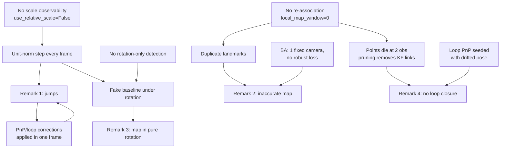

# V-SLAM Diagnosis — Root Cause Analysis

> [!abstract] Scope
> This note diagnoses the four issues raised in the review. **No code was changed.**
> Every claim below is anchored to a specific location in the repository (`file.py:line`).
>
> **Remediation plan (no code yet):** [[plan/00-INDEX|plan/00-INDEX.md]] — staged, testable fix roadmap.
>
> Reviewer remarks:
> 1. קפיצות במסלול — *jumps in the trajectory*
> 2. מפה אינה מדויקת — *the map is not accurate*
> 3. לא ברור איך הצלחת לייצר מפה בסיבוב טהור — *unclear how a map was produced under pure rotation*
> 4. לא ראיתי השפעה של LOOP CLOSURE — *no visible effect of loop closure*

---

## 0. Executive summary

All four remarks trace back to **one structural fact**: this is a *frame-to-frame visual odometry chain* with SLAM-shaped components bolted on, rather than a SLAM system. Specifically:

- There is **no consistent scale**. By default `use_relative_scale=False` (`main.py:300`), so **every** inter-frame translation is the unit vector from `cv2.recoverPose`. The camera "moves" exactly 1.0 world unit per frame regardless of what it actually did.
- There is **no gauge fixing anywhere**. Bundle adjustment fixes one camera only (`optimization.py:290`), which leaves monocular scale free to drift inside each optimisation.
- There is **no global data association**. `local_map_window=0` by default (`main.py:393`), so map points are never re-observed after they leave the previous frame, and a fresh `Point` is created for every unmatched match (`mapping.py:287`).
- There is **no degeneracy handling**. The rotation-only (homography) path is off by default (`main.py:318`) and, even when enabled, its acceptance test can essentially never fire (`tracking.py:144`).
- **Corrections are applied instantaneously to one frame** (PnP at `frame.py:434`, loop closure at `pipeline.py:874`) with no smoothing and no propagation, so every correction *is* a jump by construction.

### Remark → primary root cause

| # | Reviewer remark | Primary root cause | Where |
|---|---|---|---|
| 1 | Trajectory jumps | Unit-norm translation each frame + failed frames silently keep the **identity pose** + PnP/reloc snap corrections | `main.py:300`, `frame.py:320`, `frame.py:434` |
| 2 | Map inaccurate | Duplicate landmarks (no fusion), BA with free scale gauge / no robust kernel / no fixed outer observers, invented intrinsics, no distortion model | `mapping.py:287`, `optimization.py:290`, `dataset.py:10` |
| 3 | Map under pure rotation | Pure rotation is **never detected**; degenerate Essential matrix yields a fabricated unit baseline, which triangulates a geometrically meaningless but self-consistent point cloud | `main.py:318`, `tracking.py:144`, `frame.py:332` |
| 4 | Loop closure has no effect | Detection almost never fires (spaced candidates + pruned keyframe links); when it does, the loop PnP is *seeded with the drifted pose*, so the measured correction ≈ 0; and the map is never fused or globally re-optimised | `loop_closure.py:382`, `loop_closure.py:434`, `pipeline.py:425` |



---

## 1. קפיצות במסלול — trajectory jumps

There are **five independent jump generators**. Any one of them alone would produce visible spikes; they are all active in the default configuration.

### 1.1 Every step has length 1.0 (worst offender)

`cv2.recoverPose` returns a translation of unit norm — direction only, no magnitude. The pipeline does not recover the magnitude by default:

```300:303:main.py
    parser.add_argument('--use_relative_scale', action='store_true', default=False,
                        help='Estimate translation scale from map points for Essential path (default: False)')
    parser.add_argument('--no_relative_scale', action='store_false', dest='use_relative_scale',
                        help='Use unit translation (scale=1); test PnP without scale recovery')
```

The GUI agrees (`run_ui.py:925`, `use_relative_scale_var = tk.BooleanVar(value=False)`). So the guard in `frame.py` never runs:

```332:343:frame.py
        scale = 1.0
        if (
            use_relative_scale
            and world_map is not None
            and motion.model == "ESSENTIAL_MATRIX"
            and np.linalg.norm(t_scaled) > 1e-8
        ):
            scale = _estimate_translation_scale(
                prev_frame, self, motion.R, t_scaled,
                motion.inlier_matches, world_map,
            )
            t_scaled = t_scaled * scale
```

**Consequence.** The reconstructed path is a random walk of unit-length steps. When the true motion is slow (or zero) the estimate still advances a full unit; when the true motion is fast the estimate under-advances. Relative to any ground truth this reads as a sequence of jumps, and it is why the ratio between consecutive step lengths is wildly inconsistent.

> [!warning] Even when enabled, the scale estimator is a jump source
> `_estimate_translation_scale` (`frame.py:21`) silently **returns `1.0`** on five different early-exit paths (fewer than 5 candidates, bad median depth, too few positive scales, fewer than 3 survivors after IQR filtering). A fallback of `1.0` is not a neutral value — it is a full unit step. It should fall back to the *previous frame's* step length (constant-velocity), not to 1.0.
> The clamp `max(0.2, min(scale, 5.0))` (`frame.py:116`) also allows a 25× swing between two consecutive frames.

### 1.2 A failed frame silently keeps the identity pose

`Frame.__init__` initialises the pose to the identity:

```159:160:frame.py
        self.world_T_cam = np.eye(4, dtype=np.float64)
        self.cam_T_world = np.eye(4, dtype=np.float64)
```

If motion estimation fails, `update_pose` returns **without ever writing a pose**:

```320:325:frame.py
        motion = estimate_motion(prev_frame, self, use_homography=use_homography)
        if motion is None:
            if stats is not None:
                stats["vo_fail"] = stats.get("vo_fail", 0) + 1
            print(f"  >> VO failed for frame {self.id}")
            return
```

Relocalisation is attempted (`pipeline.py:600`), but if it also fails, `frames[k].world_T_cam` stays at the identity. The next frame then chains off that identity:

```576:578:pipeline.py
        frames[k].update_pose(
            frames[k - 1], world_map,
```

**Consequence.** A single lost frame teleports the trajectory to the world origin, and *the whole subsequent trajectory continues from the origin* rather than from where the camera actually was. In the exported TUM file and in the viewer this appears as a huge spike to `(0,0,0)`. `estimate_motion` returns `None` on fewer than 5 matches, on `findEssentialMat` failure, and on fewer than 5 inliers (`tracking.py:99`, `tracking.py:116`, `tracking.py:174`) — all realistic on a blurred or low-texture frame.

There is no constant-velocity fallback and no "hold the previous pose" fallback anywhere in the codebase.

### 1.3 PnP corrections are applied as a step function

PnP runs only every 10 frames by default (`main.py:274`):

```572:572:pipeline.py
        use_pnp = (pnp_interval > 0) and (k % pnp_interval == 0)
```

When it is accepted, the pose of frame `k` is overwritten outright, while frames `k-9 … k-1` keep their drifted poses:

```433:439:frame.py
                if pnp_step <= max_step and correction_jump <= max_correction:
                    if self.set_camera_pose(cam_T_world):
                        pnp_accepted = True
```

The gate that is supposed to prevent this is far too loose given the unit-step scale:

```419:420:frame.py
                max_step = max(3.0 * max(vo_step, 1e-6), 2.0)
                max_correction = max(2.5 * max(vo_step, 1e-6), 2.0)
```

With `vo_step == 1.0` (see §1.1), a correction of up to **2.5 world units — i.e. 2.5 frames' worth of motion — is accepted in a single frame**. This produces the classic sawtooth: 9 frames of drift, one frame of snap, repeat. The period of the sawtooth equals `pnp_interval`, which is an easy signature to confirm in an `evo_ape` error-vs-time plot.

### 1.4 Relocalisation can teleport the camera onto a keyframe

```600:613:pipeline.py
        if not hasattr(frames[k], "_last_motion") and use_relocalization and len(loop_closer.keyframes) > 0:
```

The relocalisation PnP is seeded with the **matched keyframe's** pose (`loop_closure.py:544`) and the distance sanity check is **disabled by default** (`main.py:466`, `relocalization_sanity_check_enabled=False`). A wrong keyframe match therefore places the camera at that keyframe's location with no bound on how far that is, and — because of §1.2 — the rest of the trajectory then continues from the teleported position.

### 1.5 Bundle adjustment can inject its own jumps

The BA acceptance test compares against the pre-BA window:

```666:669:pipeline.py
                max_allowed_step = max(ba_max_allowed_step_factor * max(pre_p95_step, 1e-6), pre_max_step + 2.0)
                bad_reproj = err_before > 0.0 and err_after > ba_bad_reproj_ratio * err_before
                bad_jump = post_max_step > max_allowed_step
```

`pre_max_step + 2.0` is an *additive* allowance of two full unit steps, so a two-unit teleport inside the window is always accepted. Combined with the free scale gauge in §2.2, BA every 30 frames becomes a periodic scale/position discontinuity.

> [!note] Diagnostic to confirm §1
> Plot per-frame step length `‖C_k − C_{k−1}‖`. Expect a flat line at ≈ 1.0 with spikes at multiples of `pnp_interval` (10) and `ba_interval` (30), plus occasional spikes to ≈ ‖C_{k−1}‖ (the teleport-to-origin events of §1.2).

---

## 2. מפה אינה מדויקת — the map is not accurate

### 2.1 Every landmark is duplicated many times over

Data association only ever transfers links from the **immediately previous frame**:

```162:174:mapping.py
    for m in inlier_matches:
        existing_id = prev_frame.keypoint_to_point.get(m.queryIdx)
        if existing_id is None:
            unmatched_matches.append(m)
            continue
```

Everything not matched to `k-1` becomes a brand new `Point`:

```287:301:mapping.py
        p = Point(
            point=xw,
            frames=[prev_frame.id, curr_frame.id],
            observations={prev_frame.id: m.queryIdx, curr_frame.id: m.trainIdx},
            descriptor=desc,
        )
```

The mechanism that would recover a landmark after a one-frame dropout is `local_map_track`, and it is **off by default**:

```393:394:main.py
    parser.add_argument('--local_map_window', type=int, default=0,
                        help='Number of recent frames for local map tracking (0 to disable, default: 0)')
```

**Consequence.** A physical corner that is visible for 200 frames but momentarily missed by the matcher becomes dozens of separate `Point` objects, each triangulated from a different two-frame pair with a different (fabricated) baseline, therefore at a different depth. The rendered cloud is a smeared, multi-layered "ghost" of the scene rather than a set of landmarks. There is **no point-fusion / merge step anywhere in the repository**.

There is also no cap on this: `Map(points=[], frames=frames, max_points=5000000)` (`pipeline.py:347`).

### 2.2 Bundle adjustment has a free scale gauge

Only the **first camera of the window** is held fixed:

```290:293:optimization.py
    anchor_params = _pose_to_params(frames_window[0].cam_T_world)
    cam_params_free = np.concatenate([
        _pose_to_params(f.cam_T_world) for f in frames_window[1:]
    ])
```

In a monocular problem, fixing one camera removes the 6-DoF rigid gauge but **leaves the 1-DoF scale gauge free**. Reprojection residuals are invariant to scaling the whole {points + camera translations} about the anchor centre, so LM can and will slide along that direction. Every BA run is therefore free to shrink or grow the window, which both corrupts the map (points move relative to unoptimised neighbours) and injects the step discontinuity described in §1.5. The standard remedy — fix **two** cameras, or add a unit-baseline / distance prior — is absent.

### 2.3 BA drags points without their outside constraints

Points are selected because they are visible in the window, but the frames *outside* the window that also observe them are not added as fixed observers:

```236:248:optimization.py
    point_ids_seen = set()
    for f in frames_window:
        for kp_idx, pid in f.keypoint_to_point.items():
            pt = world_map.get_point(pid)
```

So a landmark that has 20 observations, 12 of them older than the window, is moved to fit only the 8 in-window observations. The older 12 observations are silently violated. Over many BA runs, the map is repeatedly pulled toward the most recent window — a classic local-BA map-degradation pattern. ORB-SLAM avoids exactly this by adding non-window observing keyframes as *fixed* nodes.

### 2.4 No robust kernel in BA

```331:341:optimization.py
    if method == 'lm':
        result = least_squares(
            _build_residuals,
            x0,
            args=(n_frames, n_points, observations, K, anchor_params),
            jac=_build_residuals_jac if use_analytical_jacobian else '2-point',
            method='lm',
            verbose=0,
            max_nfev=25,
        )
```

`scipy.optimize.least_squares` only supports `loss=` for `trf`/`dogbox`, **never for `method='lm'`**. So this is a pure least-squares fit: a handful of mismatched observations (and after §2.1 there are many) dominate the cost quadratically and drag both poses and points. `max_nfev=25` also means the solve frequently terminates unconverged, leaving the state in a partially-optimised — i.e. inconsistent — configuration.

Related: the "point behind camera" case returns a constant residual of `100.0` (`optimization.py:178`) while the analytical Jacobian returns **zero gradient** for that same observation (`optimization.py:95`). The residual and its declared Jacobian disagree, which is a correctness violation of the LM contract and can stall or misdirect the solve.

### 2.5 The intrinsics are invented, and there is no distortion model

```10:13:dataset.py
def infer_camera_matrix(image):
    h, w = image.shape[:2]
    f = 0.9 * max(w, h)
    return np.array([[f, 0, w / 2], [0, f, h / 2], [0, 0, 1]], dtype=np.float64)
```

Unless `--default_k` is passed, the focal length is a guess. For a 640×480 TUM sequence this yields `f = 576`, whereas TUM `fr1` is `fx = 517.3, fy = 516.5` — an **11 % focal error**, plus a principal point forced to the exact image centre (TUM `fr1`: 318.6, 255.3).

Separately, **`distCoeffs=None` is passed at every single call site** (`localization.py:36`, `localization.py:155`, `loop_closure.py:430`, `loop_closure.py:550`) and images are never undistorted in `dataset.py`. TUM `fr1` has `k1 = 0.2624`, which displaces image-corner features by tens of pixels.

**Consequence.** A wrong focal length is absorbed as a systematic depth bias (the map is uniformly too deep or too shallow) and a systematic rotation/translation cross-talk that bends straight trajectories. Uncorrected radial distortion makes planar walls reconstruct as curved surfaces and inflates the epipolar/reprojection residuals that every gate in the pipeline is thresholded against.

### 2.6 The triangulation quality gates do not actually gate

```270:271:mapping.py
        if (err_prev + err_curr) > 6.0:
            continue
```

`cv2.triangulatePoints` returns the point that **minimises exactly this quantity**, so a low-parallax, wildly-wrong-depth point still passes with a sub-pixel residual. Symmetric reprojection error is not a depth-quality test. The only real test here is the parallax check (`mapping.py:239`), and see §3.3 for why it is defeated under rotation.

Likewise the baseline guard is inert:

```206:208:mapping.py
    baseline = np.linalg.norm(cam_center_curr - cam_center_prev)
    if baseline < 1e-6:
        return
```

With unit-norm translation the baseline is *always* exactly 1.0, so this can never trigger — including in the one situation it exists to catch (§3).

### 2.7 Aggressive default pruning removes the observation history

```364:367:main.py
    parser.add_argument('--prune_1obs_age', type=int, default=10, ...)
    parser.add_argument('--prune_2obs_age', type=int, default=20, ...)
```

Because there is no re-association (§2.1), the overwhelming majority of points reach exactly **2** observations and stop. Pruning then deletes them 20 frames later, along with all their frame links:

```425:441:pipeline.py
    def _remove_point_and_links(point_id):
        """Remove a map point from map and from all frame link tables."""
```

The map therefore never accumulates structure; it is a rolling ~20-frame buffer of transient points. This also directly disables loop closure (§4.2).

---

## 3. סיבוב טהור — how a map was produced under pure rotation

> [!danger] Short answer
> **It should not have been possible, and the map produced there is an artifact, not a reconstruction.**
> Under pure rotation the baseline is zero, the Essential matrix is degenerate, and 3D structure is unobservable. The pipeline nevertheless produces points because it (a) never detects the rotation, (b) accepts an arbitrary translation *direction* from the degenerate `recoverPose`, and (c) assigns that direction a **fixed magnitude of 1.0**. A fabricated baseline of 1.0 combined with a wrong-but-self-consistent R is enough for `cv2.triangulatePoints` to emit finite points with small reprojection error. They are numerically valid and geometrically meaningless.

### 3.1 The rotation-only path is disabled by default

```318:321:main.py
    parser.add_argument('--use_homography', action='store_true', default=False,
                        help='When True, choose between homography and essential matrix by threshold; when False, use essential matrix only (default: False)')
```

Confirmed in the GUI as well (`run_ui.py:923`). So `estimate_motion` never even computes H, and the Essential path is taken unconditionally.

### 3.2 Even with `--use_homography`, the selection test can essentially never pass

```144:151:tracking.py
    take_homography_path = (
        use_homography
        and H is not None
        and inliers_E > 0
        and inliers_H >= min_h_inliers
        and h_ratio >= ratio_threshold
        and (inliers_H - inliers_E) >= min_h_inlier_margin
    )
```

with `ratio_threshold=1.0` and `min_h_inlier_margin=10` (`tracking.py:87`). Under **true** pure rotation, every correspondence satisfies the homography *and* also satisfies the epipolar constraint of the degenerate Essential matrix that RANSAC finds. So `inliers_H ≈ inliers_E`, the margin is ≈ 0, and the test fails. The code comment even acknowledges this:

```142:143:tracking.py
    ''' 5 conditions to use homography. it usually fails all the time because E is at least just as 
    good except in very rare cases. kept for illustration purposes'''
```

The correct model-selection criterion is the **ORB-SLAM score ratio** `S_H / (S_H + S_E) > 0.45`, computed from *symmetric transfer errors* with a χ² weighting — not from raw inlier counts, which are structurally incapable of separating these two models.

The `else` fallback (`tracking.py:158`) is also mathematically incorrect: for a 3×3 matrix, `R = -R` flips the determinant sign but yields a rotation by a *different* angle about a *different* axis. The nearest proper rotation is `U · diag(1,1,−1) · Vᵀ`.

### 3.3 The parallax check is defeated by the wrong rotation

```239:253:mapping.py
        if min_parallax_rad is not None:
            ...
            ray_prev = R_prev_w @ (K_inv @ np.array([uv_p[0], uv_p[1], 1.0]))
            ray_curr = R_curr_w @ (K_inv @ np.array([uv_c[0], uv_c[1], 1.0]))
            ...
            if angle < min_parallax_rad:
                continue
```

Parallax is computed as the angle between the two viewing rays *after* rotating them into the world frame with the estimated `R`. Under a truly pure rotation with a **correct** `R`, the two rays for a static point would be parallel and the check would correctly reject. But the `R` recovered from a degenerate Essential matrix is not correct, so the rays are not parallel, the angle exceeds 1.5°, and the check waves the point through. The check validates the estimate against itself.

### 3.4 What that fabricated map does downstream

The bogus points are indistinguishable from good ones and immediately re-enter the estimator:

- They are counted as PnP correspondences once they reach 3 observations (`localization.py:118`), so the "drift correction" is anchored to phantom structure.
- They enter BA as landmarks to be optimised (`optimization.py:236`).
- They become the 3D side of loop-closure geometric verification (`loop_closure.py:407`).

So the rotation segment does not just produce a bad local map — it **poisons the estimator's state** for everything that follows.

### 3.5 The secondary problem, if rotation *were* detected

Even on the homography path the handling is incomplete:

```167:171:tracking.py
        #inlier_matches is empty because in pure rotation t=0 so no triangulation.
        return MotionEstimate(
            R, t, [], list(matches), "HOMOGRAPHY", inliers_E, inliers_H,
            epipolar_err_before, epipolar_err_after
        )
```

Returning an empty `inlier_matches` correctly suppresses triangulation, but it also suppresses `associate_known_points` (`frame.py:360`), so the frame gets **zero** `keypoint_to_point` links. Existing landmarks are not carried across the rotation, their observation counts stop growing, and after `prune_2obs_age` frames they are deleted. A correct implementation still *tracks* existing points through a rotation (rotation-only PnP / 2D-2D tracking), and only defers *new point creation* until parallax is regained.

---

## 4. LOOP CLOSURE — no visible effect

There are three failure layers, in order: it usually does not fire; when it fires the measured correction is near zero; and even a correct correction would not be visible in the map.

### 4.1 Candidate selection is not appearance-based

```382:393:loop_closure.py
        if not candidates:
            # Spaced path (or BoW fallback): up to num_spaced_candidates evenly-spaced keyframes.
            spaced = [
                (idx, kf) for idx, kf in self.keyframes
                if curr_idx - idx >= self.min_gap
            ]
            n = self.num_spaced_candidates
            if len(spaced) > n:
                step = max(1, len(spaced) // n)
                candidates = spaced[::step][:n]
```

The default strategy is `spaced` (`main.py:426`) — pick 5 keyframes **evenly spaced in time**, with no regard for what they look like. On a 1000-frame sequence with `keyframe_interval=20` there are ~50 keyframes; the true loop partner is one of them, and this selects 5 essentially at random. Probability of hitting it ≈ 10 %, and the check only runs every 20 frames (`pipeline.py:849`). `min_gap=100` (`main.py:433`) further removes any short loop.

BoW is the correct mechanism and it exists, but it requires ORB **and** a vocabulary file **and** a successfully built native toolbox (`loop_closure.py:39–51`); on failure it degrades silently back to `spaced` with a `UserWarning`.

Note also that `detect` returns the **first** candidate that verifies (`loop_closure.py:449`), not the best-scoring one.

### 4.2 Geometric verification is starved by pruning

```406:416:loop_closure.py
            for m in matches:
                pid = kf.keypoint_to_point.get(m.queryIdx)
                if pid is None:
                    continue
                pt = world_map.get_point(pid)
                if pt is None:
                    continue
                ...
            if len(pts_2d) < 10:
                continue
```

Verification needs the **old keyframe** to still hold ≥ 10 live 3D links. But by the time `min_gap=100` frames have passed, default pruning has deleted essentially all of that keyframe's points and stripped their links (§2.7, `pipeline.py:425`). A keyframe older than ~20 frames is, in practice, an empty shell for the purposes of loop closure. The descriptor threshold is also hardcoded to 50 in the pipeline, overriding the constructor default:

```361:365:pipeline.py
    loop_closer = LoopCloser(
        keyframe_interval=keyframe_interval,
        min_gap=min_gap,
        match_threshold=50,
```

**Check this first:** the run summary prints `Loop closure detections: N` (`pipeline.py:1066`). If that number is 0 or 1, remark #4 has nothing to do with the correction maths — detection simply never fired.

### 4.3 The loop PnP is seeded with the pose it is supposed to correct

This is the subtle one, and it is the reason a *detected* loop can still have no visible effect:

```422:438:loop_closure.py
            # Use the current pose as initial guess for PnP.
            init_rvec, _ = cv2.Rodrigues(curr_frame.cam_T_world[:3, :3])
            init_tvec = curr_frame.cam_T_world[:3, 3].reshape(3, 1).astype(np.float64)

            ok, rvec, tvec, inliers = cv2.solvePnPRansac(
                ...
                useExtrinsicGuess=True,
                rvec=init_rvec,
                tvec=init_tvec,
                flags=cv2.SOLVEPNP_ITERATIVE,
            )
```

The whole point of loop closure is to measure the **accumulated drift** — the discrepancy between where the tracker thinks it is and where the old map says it is. Here the solver is initialised at the drifted pose and refined locally with `SOLVEPNP_ITERATIVE`. It converges to the nearest local minimum, which is next to the initial guess. The recovered `cam_T_world` is therefore ≈ the current pose, and:

```836:839:loop_closure.py
    old_world_T_cam = curr_frame.world_T_cam.copy()
    corrected_world_T_cam = np.linalg.inv(corrected_cam_T_world)
    # delta @ old = corrected  =>  delta = corrected @ old^{-1}
    delta = corrected_world_T_cam @ np.linalg.inv(old_world_T_cam)
```

`delta ≈ I`. The pipeline dutifully prints `LOOP CLOSURE detected …` and `Trajectory corrected …`, the pose graph runs, and **nothing moves**. This exactly matches "I did not see the effect of loop closure."

A loop-closure PnP must be run **without** an extrinsic guess (or seeded from the *matched keyframe's* pose, as the relocalisation path correctly does at `loop_closure.py:544`), precisely so the result is independent of the drifted estimate.

### 4.4 The pose-graph optimiser has an inconsistent Jacobian

Two conventions are mixed, which will degrade convergence even when the loop constraint is correct.

**(a) The residual is not the SE(3) logarithm.**

```73:81:loop_closure.py
def _se3_log(T):
    R = T[:3, :3]
    t = T[:3, 3]
    rvec, _ = cv2.Rodrigues(R)
    return np.hstack([rvec.ravel(), t.ravel()]).astype(np.float64)
```

The true `log` of SE(3) has translation part `V(ω)⁻¹ · t`, not `t`. But the analytical Jacobian is built from `_inv_right_jacobian_se3` (`loop_closure.py:114`), which is the exact inverse right Jacobian **of the true SE(3) log**. Residual and Jacobian are for different functions.

**(b) The parameterisation is a global chart, but the Jacobian assumes a right perturbation.**

```62:70:loop_closure.py
def _params_to_world_pose(params):
    rvec = params[:3].reshape(3, 1)
    tvec = params[3:6]
    R, _ = cv2.Rodrigues(rvec)
    T = np.eye(4, dtype=np.float64)
    T[:3, :3] = R
    T[:3, 3] = tvec
```

Perturbing `params[3:6]` translates in the **world** frame. But the Jacobian uses `Ad(T⁻¹)` (`loop_closure.py:718`, `loop_closure.py:732`), which is the derivative with respect to a **body-frame right perturbation** `T · exp(δ)`, where the translation block is `R`. The two differ by exactly that rotation. `scipy.least_squares` is given `jac=jacobian` and trusts it, so with `max_nfev=50` (`loop_closure.py:744`) the optimisation terminates on a bad search direction.

> Easy verification without touching the algorithm: compare `jacobian(x0)` against `scipy.optimize.approx_fprime` on `residuals` at `x0`. The rotation block will agree; the translation block will not.

### 4.5 The map correction is a placeholder, and there is no fusion

The map-update block in the pose-graph path is visibly unfinished — it contains a stream-of-consciousness derivation left in the source:

```776:792:loop_closure.py
        k = loop_kf_idx + int(round(alpha * n_span))
        k = min(max(k, loop_kf_idx + 1), curr_idx)
        T_old = frames[k].world_T_cam  # already overwritten with optimized; we need old
        # We don't have old poses stored. Use same formula as linear: delta from curr frame
        # and interpolate. Delta at curr: corrected_world_T_cam @ inv(old_curr_pose).
        ...
        T_new_k = frames[k].world_T_cam
        T_old_k = _params_to_world_pose(x0[(k - loop_kf_idx - 1) * 6 : (k - loop_kf_idx) * 6])
        delta_k = T_new_k @ np.linalg.inv(T_old_k)
```

Note `T_old` on line 778 is computed and then never used. More importantly, the scheme applies a **single rigid `delta_k`** — derived from one frame chosen by a rounded average `alpha` — to each point. That is not a correction of the structure; it is a rigid nudge of points that happen to have been seen in the span. Points seen both **inside and before** the span are moved anyway, breaking their pre-loop observations.

And the decisive omission: **loop closure never merges the duplicate landmarks it just proved are the same** (§2.1). The entire visible benefit of a loop closure in a *map* is that the two copies of the revisited region collapse into one. Here both copies remain, both are drawn, and the map looks exactly as smeared after the closure as before.

Finally, there is **no global bundle adjustment after loop closure** anywhere in the pipeline. Frames after `curr_idx` are never revisited, and the pose graph spans only `[loop_kf_idx, curr_idx]`.

---

## 5. Cross-cutting issues

| Issue | Location | Effect |
|---|---|---|
| Frame IDs start at 1, sequence indices at 0 | `frame.py:18`, `frame.py:155` | `frames[i].id == i+1`. Currently handled by explicit maps (`loop_closure.py:761`), but it is a standing trap for any index arithmetic. |
| `Map.add_point` evicts `points[0]` without cleaning frame links | `Map.py:22` | Dangling `keypoint_to_point` entries if `max_points` is ever lowered from `5_000_000`. |
| GT overlay drawn without Sim(3)/Umeyama alignment | `visualizer.py:457` | A monocular estimate at arbitrary scale is drawn against a metric GT. The visual comparison is meaningless; `evo_ape --align --correct_scale` is required. |
| `local_map_track` thresholds are very permissive | `mapping.py:101` (`max_desc_dist` 64 Hamming / 200 L2, 40 px radius) | If enabled, admits many wrong 2D–3D links, which then have no robust kernel to protect them in BA (§2.4). |
| `least_squares(method='lm')` uses a dense Jacobian | `optimization.py:333` | `~816` parameters for 250 points; no sparsity structure exploited, hence `max_nfev=25` and unconverged solves. |
| Behind-camera residual `100.0` vs zero Jacobian | `optimization.py:180` / `optimization.py:95` | Discontinuous, non-differentiable cost presented to LM as smooth. |

---

## 6. What to fix, in order

> [!tip] Ordered by (impact on the four remarks) ÷ (effort). Items 1–4 address all four remarks.

1. **Fix scale.** Either enable and harden `use_relative_scale` (fall back to the *previous step length*, never to `1.0`) or, better, do a proper two-view initialisation with a fixed baseline and thereafter propagate scale from the map via PnP only. → remarks 1, 2, 3.
2. **Never leave a frame at the identity pose.** On VO + relocalisation failure, carry forward the previous pose (or a constant-velocity prediction) and mark the frame as invalid so it can be excluded from export and from BA. → remark 1.
3. **Turn on real data association.** Set `local_map_window` > 0 with tight thresholds, and add a **point-fusion pass** that merges landmarks agreeing in 3D position and descriptor. Then relax pruning so points survive long enough to be re-observed. → remarks 2, 4.
4. **Implement proper model selection for pure rotation.** ORB-SLAM's `S_H/(S_H+S_E)` score ratio on symmetric transfer errors, not inlier counts. When rotation is detected: keep tracking existing points, add rotation-only observations, **create no new landmarks**, and defer triangulation until parallax is regained. → remark 3.
5. **Fix the loop-closure PnP seeding.** Drop `useExtrinsicGuess=True` in `LoopCloser.detect`, or seed from the matched keyframe. This alone should make the loop correction non-zero. → remark 4.
6. **Fix the pose-graph maths.** Make `_se3_log` the true SE(3) log (apply `V⁻¹`), and make the parameterisation and Jacobian use the same perturbation convention. Validate against `approx_fprime`. → remark 4.
7. **Replace `spaced` candidate selection** with BoW, or at minimum score all keyframes by descriptor-match count and take the top-k rather than an arbitrary time-spaced sample. → remark 4.
8. **Fix BA gauge and robustness.** Fix **two** cameras (or add a scale prior), add non-window observing keyframes as fixed nodes, switch to `method='trf'` with `loss='huber'`, and exploit `jac_sparsity` (the pose-graph code already does this correctly — `loop_closure.py:693` — so the pattern exists in the repo). → remarks 1, 2.
9. **Fix calibration.** Use the dataset's real `K` and `distCoeffs`; undistort in `dataset.py` or pass `distCoeffs` to every `solvePnP*` / `projectPoints` call. → remark 2.
10. **Add a global BA after each accepted loop closure**, and merge the duplicate landmarks across the loop. → remarks 2, 4.

---

## 7. Suggested experiments to substantiate the diagnosis

| # | Experiment | Expected result if the diagnosis is right |
|---|---|---|
| A | Plot per-frame step length `‖C_k − C_{k−1}‖` | Flat at ≈ 1.0, with spikes at multiples of 10 (PnP) and 30 (BA), plus teleports to origin |
| B | Log `frames[k].world_T_cam` whenever `_last_motion` is absent and relocalisation fails | Confirms the identity-pose frames of §1.2 |
| C | Count distinct `Point` objects within a 1 cm radius of each other | Reveals the duplication factor of §2.1 |
| D | Log the loop-closure `delta` (`loop_closure.py:839`) as translation norm + rotation angle | Expect ≈ 0 — proves §4.3 |
| E | Compare `jacobian(x0)` with `approx_fprime(residuals, x0)` | Rotation block matches, translation block does not — proves §4.4 |
| F | Re-run with `--use_relative_scale --local_map_window 10 --pnp_interval 3 --no_prune_low_obs` | Jump amplitude and map smearing should both drop substantially, without any code change |
| G | Re-run rotation-only segment with `--min_parallax_deg 5` | Point creation should drop sharply, confirming that §3 points are low-parallax artifacts |
| H | `evo_ape tum gt.txt est.txt -va --correct_scale` vs. without `--correct_scale` | A very large gap confirms the scale problem of §1.1 |
